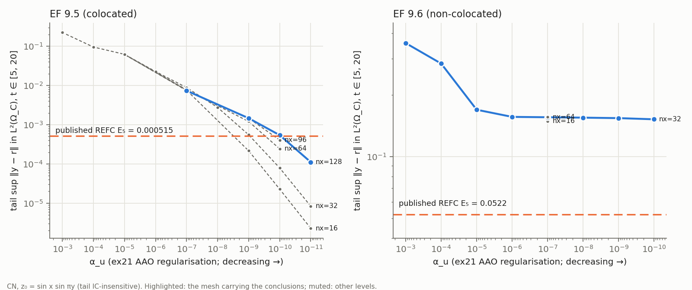

# ErrorFeedback 2026, Example 9.5 — tail-scale cross-method benchmark (2D, colocated)

Source audit: `ERRORFEEDBACK_95_96_SOURCE_AUDIT.md`. Campaign:
`errorfeedback_95_96/scripts/run_ef_campaign.sh`, stages 1–5. Table:
`results/errorfeedback_95_aao_runs.csv` (`summarize.py`). Figure:
`errorfeedback_95_96/ef_alpha_sweep.{png,pdf}` (`plot_sweep.py`). All runs are
serial with single-thread BLAS.

Binaries:
* stage-1 runs: `1ed6ad46…`;
* later stages: `705902bd…`.

The EF code path is bit-identical between the two:
`logs/bitcheck_ef95_a1e-7_sinsin_cn_nx32_nz12_nt400_stage2bin.log` has 411
gate/tail/series lines and a RESULT line identical to stage 1.

## 0. Classification

**B — tail-scale cross-method benchmark (tail IC-insensitive; the `α_u`
matching the published `E₅` is given as a mesh-dependent upper bound only).**

* **Same plant, different control method.** The source uses a REFC cascade at
  unpublished `α, β`; ex21 computes the finite-horizon AAO optimum at `α_u`.
  `α_u` is never identified with the source's parameters.
* The AAO tail error decreases monotonically with `α_u`, with no floor, and
  is IC-insensitive.
* The published `E₅ = 5.15e-4` is attained by the AAO optimum. The `α_u` at
  which this happens is **not mesh-converged**. On the finest affordable mesh
  (nx 128) it is `9.3e-11`. That is an upper bound for the converged value,
  under the monotonicity assumption of §5.
  **AAO regularisation yielding the same published tail scale: `α_u ≲ 1e-10`.**

## 1. Data used

| datum | value | tag |
|---|---|---|
| plant | `Ω = (0, π) × (0, 1)`, `z_t = Δz − (2, 1)·∇z + χ_B u + χ_d d`, homogeneous Dirichlet | [A] |
| regions | `Ω_B = Ω_C = [3π/8, π/2] × [1/3, 2/3]`, `Ω_d = [3π/4, 7π/8] × [1/3, 2/3]` | [B], asserted by the user ("sufficiently confirmed"); the source figures are schematic (audit §3) |
| signals | `r = x e^{−(y−½)²/σ²} sin 2t` on `Ω_C`; `d = x e^{−(y−½)²/σ²} cos 3t` on `Ω_d`; `σ = 0.15`; no switch-on | [A] |
| `T`, metric | `T = 20` (axes) [B]; `sup_{t∈[5,20]} ‖y − r‖_{L²(Ω_C)}` (window immaterial: [2,20], [5,20] and [10,20] agree to 4e-5 relative in every run) | [B] |
| terminal layer | the AAO adjoint vanishes at `T`. In every run `sup_[5,20]` equals `sup_[5,18]` to ≤ 2e-4 relative; the sup sits at interior periodic peaks (`t ≈ 5.5, 11.8, 13.35, 16.5`), so no exclusion is needed | ex21 |
| IC | not stated: tested `0`, `sin x sin πy`, `16x(π−x)y(1−y)/π²` | [C] → immaterial (§3) |
| published | Table 9: `E₁…E₅ = 1.25e-2, 3.93e-3, 1.70e-3, 8.76e-4, 5.15e-4` | [A] |
| AAO functional | `½∫‖y − r‖²_{L²(Ω_C)} + (α_u/2)∫‖u‖²_{L²(Ω_B)}`, `α_track = 1` | ex21 |

Preset: `--errorfeedback-95 [--ef-initial zero|sinsin|poly] --alpha-u <a>`
(`ApplyErrorFeedback9x`, `include/Benchmark2D.cpp`). `nx` must be a multiple
of 8 and `nz` a multiple of 3, so all region edges are element faces.

## 2. Gates (all pass)

| gate | CN | BE |
|---|---|---|
| region measures (un-eliminated) `Ω_B, Ω_C, Ω_d` | `π/24` each to 1e-15 | |
| load `1ᵀ M_d I_h(x²y²)` vs exact | 2.215517294301901e-1 (= exact; `Ω_d` is interior, so the production load is identical) | |
| orientation `C·x = v M1` (x / y) | 3.4e-14 / 2.4e-14 (transposed: 11.5 / 6.9) | same |
| skew `‖C + Cᵀ‖/‖C‖` | 1.2e-14 | same |
| shell transpose | 9.9e-18 | 1.8e-17 |
| reduced-Hessian symmetry, production adjoint | 7.5e-15 | 8.8e-14 |
| FD gradient, production adjoint | 2.5e-14 | 4.5e-14 |
| negative control (ex20-style adjoint) | 34 % (fails as it must) | 24 % |
| gradient at the production optimum | 7.8e-12 | 1.6e-5 (1 outer iteration, true residual 3.6e-9: stationarity at solver tolerance) |
| independent march vs production | ≤ 2.5e-14 (all production runs) | ≤ 1.6e-14 |
| Dirichlet trace | ≤ 2e-16 | |
| solver | SCHUR_SWEEP, **2 outer iterations in every run**, true residual ≤ 3.2e-13, 0 sweep failures | |

## 3. IC sensitivity (nx 32, nz 12, CN, N = 400)

| `α_u` | tail sup `[5,20]`, `z₀ = 0` | `sin x sin πy` | poly | max relative spread |
|---|---|---|---|---|
| 1e-5 | 6.2427894e-2 | 6.2427666e-2 | 6.2427649e-2 | 3.9e-6 |
| 1e-7 | 8.8542654e-3 | 8.8542652e-3 | 8.8542652e-3 | 2.2e-8 |
| 1e-9 | 5.5408601e-4 | 5.5408599e-4 | 5.5408599e-4 | 3.8e-8 |

**The tail is IC-insensitive**, as expected: the slowest plant decay rate is
`1 + π² + |V|²/4 ≈ 12.1`.

## 4. Refinement

Péclet number `|V| h_max / 2`: 0.22 (nx 16), 0.11 (32), 0.055 (64), 0.037 (96),
0.027 (128). Standard Galerkin is stable. Tail sup on `[5, 20]`, CN:

| `α_u` | nx 16 (N 400) | nx 32 (N 400) | nx 64 (N 400) | nx 96 (N 200) | nx 128 (N 200) | converged? |
|---|---|---|---|---|---|---|
| 1e-5 | 6.1993e-2 | 6.2428e-2 | 6.2323e-2 | 6.2180e-2 | — | **yes** (0.2 %) |
| 1e-7 | 7.592e-3 | 8.854e-3 | 7.794e-3 | 7.442e-3 | 7.379e-3 | **yes** (0.8 %, non-monotone at coarse levels) |
| 1e-9 | 2.167e-4 | 5.541e-4 | 1.2095e-3 | 1.4723e-3 | 1.4686e-3 | **yes** (0.25 %) |
| 1e-10 | 2.28e-5 | 7.90e-5 | 2.420e-4 | 4.069e-4 | 5.423e-4 | **no** (+33 % from 96 to 128) |
| 1e-11 | 2.29e-6 | 8.37e-6 | — | — | 1.115e-4 | no |

**Time.** At nx 64, `α_u = 1e-9`, N = 200 / 400 / 800 gives 1.2040 / 1.2095 /
1.2109e-3; BE with N 800 gives 1.2113e-3. At `α_u = 1e-10`: 2.4066 / 2.4199 /
2.4232e-4, BE 2.4226e-4. The time error at N = 200 is 0.6 %.

**Why small `α_u` converges slowly in space.** As `α_u → 0` the colocated
optimum tries to make `y = r` on `Ω_C`. `r` is not compatible with the field
outside `Ω_C`, so the ideal control concentrates on `∂Ω_C` (a layer, which in
the limit is a measure that is not in `L²`). A finer mesh resolves the layer
more faithfully, which makes exact tracking *more* expensive. The coarse
meshes therefore *under*-estimate the error, as in Mathematics 2025 Ex. 4. The
non-monotone behaviour at `α_u = 1e-7` is the same effect at a coarser
resolution.

Memory limit: nx 128 with N 400 was OOM-killed when run in parallel (30 GB
node). nx 128 runs therefore use N 200 (0.6 % time error), and finer meshes
were not attempted. The OOM-killed attempts were rerun or dropped, and their
partial logs were removed.

## 5. `α_u` sweep and the published tail level

nx 32 (complete sweep, `z₀ = sin x sin πy`):

| `α_u` | tail sup | tail RMS | `‖u‖_{L²}` | outer its |
|---|---|---|---|---|
| 1e-3 | 2.2509e-1 | 1.6178e-1 | 17.8 | 2 |
| 1e-4 | 9.5846e-2 | 6.8905e-2 | 37.5 | 2 |
| 1e-5 | 6.2428e-2 | 4.4853e-2 | 58.4 | 2 |
| 1e-6 | 2.2748e-2 | 1.6347e-2 | 116.1 | 2 |
| 1e-7 | 8.8543e-3 | 6.3632e-3 | 158.8 | 2 |
| 1e-8 | 2.7644e-3 | 1.9864e-3 | 213.2 | 2 |
| 1e-9 | 5.5409e-4 | 3.9790e-4 | 249.3 | 2 |
| 1e-10 | 7.9012e-5 | 5.6718e-5 | 261.7 | 2 |
| 1e-11 | 8.3657e-6 | 6.0050e-6 | 263.9 | 2 |

The tail falls monotonically with no floor (colocated: `L = 0`, as in
Mathematics 2025 Ex. 4).

**`α_u` at which the AAO tail equals the published `E₅ = 5.15e-4`**
(log–log interpolation between computed decades; no tuned runs):

| mesh | bracket | `α_u(E₅)` |
|---|---|---|
| nx 32 | 1e-9 … 1e-10 | 9.2e-10 |
| nx 64 (N 400 / 800 / BE 800) | 1e-9 … 1e-10 | 2.95e-10 / 2.94e-10 / 2.94e-10 |
| nx 96 | 1e-9 … 1e-10 | 1.5e-10 |
| nx 128 | 1e-10 … 1e-11 | **9.3e-11** |

At `α_u = 1e-10` and `1e-11` the tail increases monotonically over every
mesh level computed (5 levels and 3 levels respectively), and it decreases
with `α_u`. **Assuming that monotone growth persists under further
refinement**, the mesh-converged `α_u(E₅)` is **at most** 9.3e-11. The
assumption is not proven: at `α_u = 1e-7` the convergence was non-monotone at
coarse levels. Its value is not determined: four levels drift by a factor of
10, and the empirical order is ≈ 0.6. Converged anchors are tail = 1.47e-3 at
`α_u = 1e-9` (2.9 × `E₅`) and 7.38e-3 at `1e-7`.

**All five published levels on the finest-mesh anchors.** These are the
nx 128 values (nx 96 at `α_u = 1e-5`), interpolated log–log between computed
decades. Brackets marked "2 decades" interpolate across an uncomputed decade.

| level | Table 9 | `α_u` with the same AAO tail | bracket | status |
|---|---|---|---|---|
| `E₁` | 1.25e-2 | 3.1e-7 | 1e-5 … 1e-7 (2 decades) | both anchors converged |
| `E₂` | 3.93e-3 | 1.7e-8 | 1e-7 … 1e-9 (2 decades) | both anchors converged |
| `E₃` | 1.70e-3 | 1.5e-9 | 1e-7 … 1e-9 (2 decades) | both anchors converged |
| `E₄` | 8.76e-4 | 3.0e-10 | 1e-9 … 1e-10 | upper bound (1e-10 not converged) |
| `E₅` | 5.15e-4 | 9.3e-11 | 1e-10 … 1e-11 | upper bound |

**Each published REFC level is attainable by the AAO optimum on the same
plant.** Successive levels need roughly 5–20× smaller `α_u`.

## 6. What may and may not be concluded

* **May.** On the asserted geometry the plant supports tail errors at the
  published scale. The AAO optimum reaches every Table 9 level, the last one
  only at `α_u ≲ 1e-10`, with control effort `‖u‖ ≈ 340` (nx 128). This
  matches the source's colocated "geometric decrease" structurally: the tail
  keeps falling with decreasing regularisation.
* **May not.** The two regularisations are not equivalent, and the
  controllers are not comparable. No converged value of `α_u(E₅)` is given:
  the "AAO regularisation yielding the same published tail scale" is an upper
  bound, `≲ 1e-10`.
* **STOP-condition check.**
  * The tail is IC-insensitive (≤ 4e-6).
  * Gates pass and residuals are ≤ 3e-13.
  * Spatial convergence holds for `α_u ≥ 1e-9` and **fails for `α_u ≤ 1e-10`**
    on affordable meshes. Accordingly, no number is claimed there; only a bound
    is.
