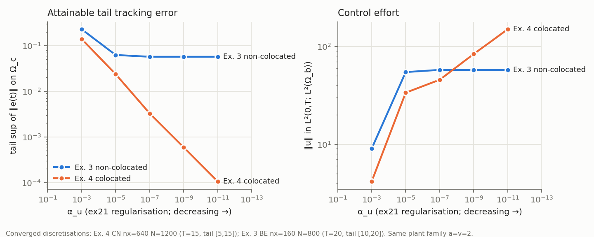

# Mathematics 2025, Example 4 — colocated benchmark and the contrast with Example 3

Source data and tags: `MATH2025_EX4_SOURCE_AUDIT.md`. Scripts, logs:
`math2025_ex4/`; tables `results/math2025_ex3_ex4_alpha_sweep.csv`,
`results/math2025_ex4_source_levels.csv`; figure
`math2025_ex4/ex3_ex4_alpha_sweep.{png,pdf}`. Serial, single-thread BLAS.
Binaries: `math2025_ex4/logs/binary.sha256` (stage 1),
`binary_stage2.sha256` (stage 2 and final; adds only the sensitivity CLI flag
`--ex3-alpha-u`).

## 0. What kind of comparison this is (A2)

Example 4 has **no source finite-horizon optimal control** and **no printed
absolute level**. It has Table 2 (ratios of successive cascade levels) and
vector figures whose cascade levels reproduce Table 2 to 4 digits.

**Classification: C (structural) for the primary question, with a
B-class (semi-quantitative, figure-derived) cross-check of scales.**

* Same physical plant and geometric structure as the source (`ℓ = 1`,
  `a = v = 2` [B], colocated `Ω_b = Ω_c = [0.45, 0.55]`, `Ω_d = [0.7, 0.8]`,
  signals (78), `T = 15` [A]).
* **Different control methodology**: cascade iterations at Tikhonov `α`
  (source) vs the finite-horizon quadratic optimum at `α_u` (ex21). `α` and
  `α_u` regularise different problems and are never identified.
* Primary question: **does the colocated geometry remove the non-trackable
  floor seen in Example 3, consistent with the source's geometric decrease?**

## 1. Implementation (A3)

Preset `--math2025-ex4` (`ApplyMath2025Example4` in
`include/Math2025Benchmark.cpp`) reuses the validated Example 3 preset and
changes only the geometry (`Ω_b = Ω_c = [0.45, 0.55]`, `Ω_d = [0.7, 0.8]`),
`T` (default 15) and the IC option (`--ex4-initial zero|x1mx`, default zero);
`α_u` stays under `--alpha-u` (no source value exists). The shared driver
gained, for Example 4 only: its own labels (`EX21_EX4_*`), region/data/load
gate expectations, tail metrics on `[0,15]`, `[5,15]`, `[10,15]`, and the
**free response** `‖χ_c S(t) z₀‖` used to identify the IC. Example 3's output
is byte-identical to before (413 lines diffed). No generic solver code changed.

    TimeOptCtrl_ex21 --math2025-ex4 --ex4-initial x1mx --alpha-u <a> \
        --time-scheme cn --pc-schur-sweep --nx 640 --steps 1200 --no-paraview

`nx` must be a multiple of 20 (all region endpoints on element faces).

## 2. Plant verification (A4) — all pass

| gate | result |
|---|---|
| region measures `Ω_b`, `Ω_c`, `Ω_d` | 0.1, 0.1, 0.1 (15 digits, endpoints on faces) |
| IC `x(1−x)`: interpolation, trace | exact (2e-17), trace 0 |
| `F`, `r(0.5,t)`, `d(0.75,t)` at `t = 0 … 10` | closed forms (F(1.5) = 0.5) |
| load `1ᵀ M_d I_h(x²)` | 0.056333333333333 = `∫_{0.7}^{0.8} x²` |
| convection sign/orientation (this config) | `C·x` vs `2 M1`: 2.2e-13 (transposed 29.5) |
| skew of `C` on free DOFs | 1.5e-14 |
| shell transpose `⟨Ex,y⟩ − ⟨x,Eᵀy⟩` (CN / BE) | 9.6e-18 / 2.0e-17 |
| reduced Hessian symmetry, production adjoint | 4.9e-13 / 2.9e-13 |
| FD reduced gradient, production adjoint | 1.4e-14 / 3.6e-14 |
| negative control (ex20-style adjoint) | 4.1 % / 3.8 % gradient error (fails as it must) |
| gradient at the production optimum | 2.3e-9 / 1.9e-9 |
| independent march vs production state | ≤ 1.7e-12; Dirichlet trace ≤ 9e-20 |

## 3. Refinement (A5, prerequisite)

Tail metric `sup_{t∈[5,15]} ‖y − r‖_{L²(Ω_c)}` (signals fully on from `t = 3`).

* **Time** (CN, nx = 40, `α_u = 10⁻⁹`): N = 300, 600, 1200, 2400 →
  6.7159, 6.7170, 6.7175, 6.7176 × 10⁻⁴; BE N = 1200, 2400: 6.7185, 6.7181.
  On the fine mesh (nx = 320): N = 1200 → 2400 changes the tail by 1.5e-5
  (`α_u = 10⁻⁹`) and 1e-5 (`α_u = 10⁻¹¹`) relative. **Converged.**
* **Space — essential at small `α_u`.** The colocated optimum develops layers
  at the edges of the narrow `Ω_b = Ω_c` as `α_u → 0` (the source likewise
  notes that "the control becomes progressively rougher"):

  | `α_u` | nx = 40 | 80 | 160 | 320 | 640 |
  |---|---|---|---|---|---|
  | 1e-3 | 0.140281 | = | = | = | = |
  | 1e-5 | 2.37599e-2 | = | = | = | = |
  | 1e-7 | 3.28156e-3 | 3.27620e-3 | 3.27589e-3 | 3.27587e-3 | 3.27587e-3 |
  | 1e-9 | 6.7175e-4 | 5.9897e-4 | 5.9189e-4 | 5.9150e-4 | **5.9148e-4** |
  | 1e-11 | 7.03e-5 | 1.2555e-4 | 1.1292e-4 | 1.0573e-4 | **1.0526e-4** |

  At `α_u = 10⁻¹¹` the coarse mesh *under*-estimates the error by 33 %;
  nx = 320 → 640 changes it by 0.45 %. All reported values use nx = 640.
* **IC**: zero vs `x(1−x)` changes the tail by < 1e-8 relative (the IC
  transient has decayed by `t = 5`).

## 4. `α_u` sweep — converged (CN, nx = 640, N = 1200, `z₀ = x(1−x)`)

| `α_u` | tail sup `[5,15]` | tail RMS `[5,15]` | `J_track` | `J_reg` | `J_total` | `‖u‖_{L²}` | outer its | true res | failures | wall s |
|---|---|---|---|---|---|---|---|---|---|---|
| 1e-3 | 1.40281e-1 | 1.00142e-1 | 6.6933e-2 | 8.6653e-3 | 7.5599e-2 | 4.163 | 2 | 1.5e-11 | 0 | 157 |
| 1e-5 | 2.37599e-2 | 9.65678e-3 | 6.4401e-4 | 5.6629e-3 | 6.3069e-3 | 33.654 | 2 | 1.2e-10 | 0 | 183 |
| 1e-7 | 3.27587e-3 | 2.33688e-3 | 5.5960e-5 | 1.0421e-4 | 1.6017e-4 | 45.653 | 2 | 1.3e-10 | 0 | 176 |
| 1e-9 | 5.91475e-4 | 4.21771e-4 | 2.0594e-5 | 3.4977e-6 | 2.4091e-5 | 83.638 | 2 | 1.3e-10 | 0 | 187 |
| 1e-11 | 1.05255e-4 | 7.50516e-5 | 1.9439e-5 | 1.1235e-7 | 1.9552e-5 | 149.902 | 2 | 1.3e-10 | 0 | 165 |

(`J_track` at small `α_u` is dominated by the IC transient at `t < 0.5`, which
no control removes; the tail metrics are IC-independent.) Solver: SCHUR_SWEEP,
**2 outer iterations at every `α_u` down to 10⁻¹¹** — the colocated optimality
system is much better conditioned for the matching Schur approximation than
Example 3's (CN 4–22 iterations there).

**Example 3 under the same sweep** (BE, nx = 160 ≡ nx = 40, N = 800, `z₀ = 0`,
tail `[10, 20]`; sensitivity flag `--ex3-alpha-u`):

| `α_u` | 1e-3 | 1e-5 | 1e-7 | 1e-9 | 1e-11 |
|---|---|---|---|---|---|
| tail sup | 0.229365 | 0.062552 | **0.0571142** | **0.0571140** | **0.0571140** |
| `‖u‖_{L²}` | 9.02 | 54.65 | 57.59 | 57.62 | 57.62 |
| outer its | 2 | 2 | 2 | 2 | 5 |

## 5. Colocated vs non-colocated (F)

* **Example 3 (non-colocated)** reaches its floor by `α_u = 10⁻⁷`: the tail
  stays at 0.0571140 to 6 digits for three decades of `α_u`, and the control
  effort saturates at ‖u‖ ≈ 57.6 — further control buys nothing in the
  tested range. This is the numerically observed floor already analysed: over
  `α_u = 10⁻⁷ … 10⁻¹¹` the remaining error on `Ω_c` is not reduced from the
  disjoint `Ω_b`. It is observed to 6 digits, not proved as a continuum
  reachability obstruction.
* **Example 4 (colocated)** shows **no floor in the tested range**: the tail
  falls monotonically, with local slope `d ln e/d ln α_u ≈ 0.37–0.43`
  (≈ 5.6× per factor 100 in `α_u`), to 1.05e-4 at `α_u = 10⁻¹¹` — **540×
  below Example 3's floor** — while ‖u‖ keeps growing (4 → 150).
* **What may and may not be concluded.** The sweep supports "the colocated
  attainable error keeps decreasing as `α_u` decreases, without saturation
  down to `10⁻¹¹`", consistent with `L = 0` for the colocated geometry
  (source Lemma 3). It does **not** prove convergence to zero as `α_u → 0`; the
  power law is an empirical local fit over 8 decades.

## 6. Relation to the source's cascade results (A6, G)

* **Structural agreement.** The source shows the cascade errors decreasing
  geometrically with each level in the colocated case (Table 2, ratios
  0.85–0.98 for `j ≥ 2`, "the first step … always produces an outlier"), and,
  in Example 3, levelling off at a floor. ex21 shows the matching structure in
  its own parameter: decreasing `α_u` keeps reducing the colocated
  finite-horizon attainable error, but not the non-colocated one. **Different
  parameter sequences (cascade level `j` vs `α_u`) are not compared directly.**
* **Figures.** Figs. 35–40 were vector-extracted (§2 of the audit); value
  quantum 2e-8 … 6e-6, calibration ≤ 2e-4 in t, and the tail sups reproduce
  Table 2 to 4 digits (raw CSVs `results/math2025_ex4_fig{35..40}_raw.csv`; no
  cleanup was applied, so there are no processed variants).
* **Semi-quantitative scale (B).** By log–log interpolation of the converged
  sweep (no tuned runs), the AAO tail equals the source's figure-derived
  cascade `e₅` tail at:

  | cascade `α` | cascade `e₅` tail `[5,15]` | AAO `α_u` with the same tail | AAO ‖u‖ there |
  |---|---|---|---|
  | 1e-3 | 7.634e-2 | ≈ 2.1e-4 | ≈ 8.5 |
  | 1e-5 | 6.724e-3 | ≈ 5.3e-7 | ≈ 41 |
  | 1e-7 | 1.488e-3 | ≈ 1.2e-8 | ≈ 60 |
  | 1e-9 | 3.124e-4 | ≈ 1.8e-10 | ≈ 104 |

  Every cascade level is attainable by the finite-horizon optimum on the same
  plant, at a regularisation `α_u ≈ 0.05–0.2 α`. This is a statement about
  attainable tracking *scales* on a common plant; it does not equate the two
  regularisations or the controllers.

## 7. Conclusion

Same plant and geometric structure, different control methodology, **structural
agreement** (no numerical reproduction is possible or claimed): colocation
removes the non-trackable floor of Example 3 and the attainable tail error keeps
decreasing with the control regularisation, as the source's geometric cascade
decrease indicates. As a by-product, Example 4's unstated plant IC was
numerically identified as consistent with `x(1−x)` (4-digit match of Fig. 40's
transient), and its time axis confirms `a = v = 2`.
