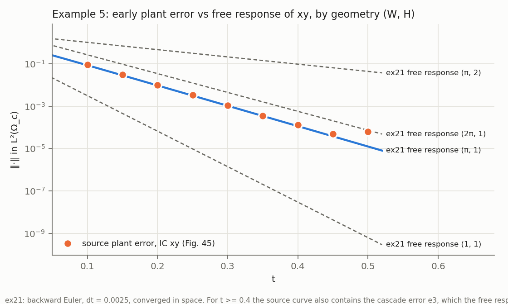
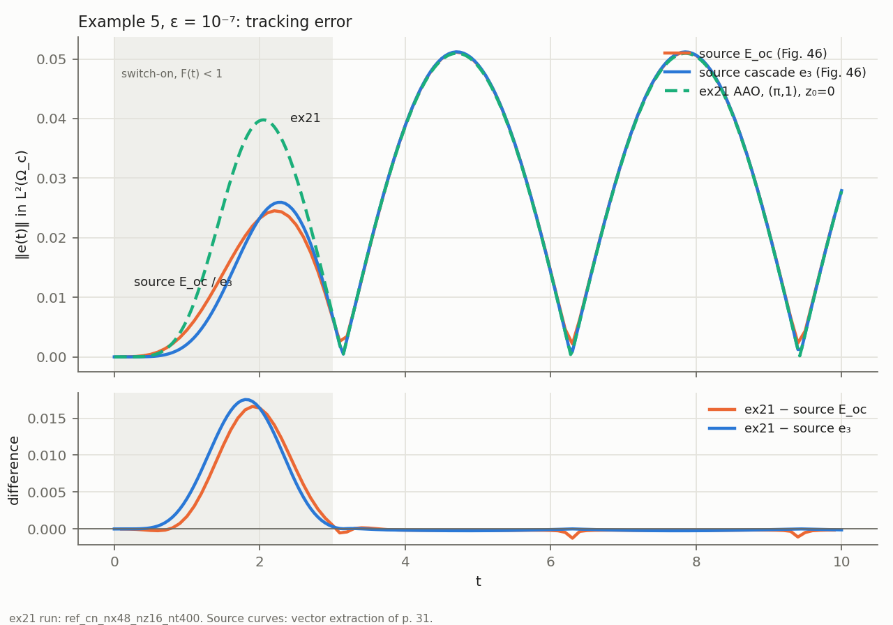

# Mathematics 2025, Example 5 — 2D non-colocated optimal-control benchmark

Source data and tags: `MATH2025_EX5_SOURCE_AUDIT.md`. Scripts and logs are in
`math2025_ex5/` (`run_ex5_campaign.sh`, `run_ex5_campaign2.sh`,
`extract_figs.py`, `compare.py`, `plot.py`). Tables:
`results/math2025_ex5_comparison.{csv,json}` and
`results/math2025_ex5_fig{45,46}_*`. Figures: `math2025_ex5/ex5_fig46_comparison.{png,pdf}`
and `math2025_ex5/ex5_fig45_free_response.{png,pdf}`. All runs are serial with
single-thread BLAS.

Binaries:
* stage 1 `1ed6ad46…` (`logs/binary.sha256`): gates, refinement, geometry, IC.
* stage 2 `705902bd…` (`logs/binary_stage2.sha256`): adds the free-response
  output and the sensitivity-only `--ex5-variant`. The ErrorFeedback path was
  checked bit-identical across the two binaries (411 output lines).

## 0. Classification

**B-strong for the plant and geometry; same-problem quantitative agreement in
the periodic regime only.**

* `(W, H) = (π, 1)` [B] **clearly beats** `(1, 1)`, `(π, 2)` and `(2π, 1)`.
  Two independent observables show it: the controller-independent free
  response of Fig. 45 (§3.1) and the `E_oc` comparison of Fig. 46 (§3.2). The
  alternatives miss by factors of 3 to 1000; `(π, 1)` is within 0.4 % at the
  peaks.
* The OC run's IC is `z₀ = 0` [B]. It is not ambiguous (audit §3), and an
  `xy` IC would not change the periodic comparison (§3.2).
* **Periodic regime `[3, 9.5]`** (signals fully switched on): ex21 agrees with
  the source `E_oc` to L∞ 1.25e-3 (2.4 % of the peak) and RMS 3.0e-4, with
  zero phase shift. Against the source cascade `e₃` the agreement is L∞
  3.2e-4.
* **Transient `[0, 3]`: the source is NOT reproduced.** The gap is 1.66e-2 at
  `t ≈ 2`. ex21's converged and verified optimum is higher there than both
  source curves. Under the reconstructed source data, the published transient
  is not reproduced by the converged ex21 optimum, and it is inconsistent with
  that optimum of the stated problem (§4). The cause is not identified.

## 1. Implementation

Preset `--math2025-ex5` (`ApplyMath2025Example5` in `include/Benchmark2D.cpp`):
* `Ω = [0, W] × [0, H]`, with `--ex5-geometry W H` (default `π 1`, [B]).
* `a = 2`, `V = (2, 2)`, homogeneous Dirichlet.
* Thirds of `W` for `Ω_b`, `Ω_c`, `Ω_d`.
* `r`, `d` as (86)–(87), with the Ex. 1 smoothstep `F`.
* `α_track = 1`, `α_u = ε = 10⁻⁷`, fixed and not overridable.
* `--ex5-initial zero|xy`; `T` defaults to 10.

`nx` must be a multiple of 3 so the region edges fall on element faces.

The shared 2D driver `RunBenchmark2D` (also used by ErrorFeedback 9.5/9.6) does
the following:
* region, IC, data and load gates on an **un-eliminated** assembly. The
  production matrices have the Dirichlet rows removed, and here all three boxes
  touch `∂Ω`;
* the production solve;
* an independent LU forward march;
* the Dirichlet trace;
* the cell Péclet number;
* the error series and window metrics;
* for Ex. 5 only, the free response `‖χ_c S(t) xy‖`.

The existing Example 3/4 driver is untouched. Sensitivity-only:
`--ex5-variant d-zero|d-noswitch` (§4).

    TimeOptCtrl_ex21 --math2025-ex5 [--ex5-geometry W H] [--ex5-initial zero|xy] \
        --nx 48 --nz 16 --steps 400 --time-scheme cn --pc-schur-sweep --no-paraview

**Cell Péclet number** `|V| h / (2a)`: 0.185 (nx 12), 0.093 (nx 24), 0.046
(nx 48). Standard Galerkin is stable throughout, with no oscillation in any
series.

## 2. Gates (all pass)

| gate | result |
|---|---|
| region measures (un-eliminated) `Ω_b, Ω_c, Ω_d, Ω` | `π/3` each to 1e-15, `π` |
| IC `xy`: interpolation; trace removed by the Dirichlet space | 2.2e-16; max trace 3.14 removed (expected: `xy ≠ 0` on `x = W`, `y = H`) |
| data `r`, `d` at `t = 0, 0.75, 1.5, 3, 10` | closed forms |
| load `1ᵀ M_d I_h(x²y²)` (Q2-exact) | 2.424359081998751 = exact. The production load drops boundary rows (inherited `M_elim I_h f`): 2.292, an O(h) consistency error that refinement removes (§3.3) and that does not matter here (`d` has < 1e-4 effect, §4) |
| convection orientation `C·x = v M1` (x, y) | 2.2e-14, 7.9e-15 (transposed: 9.1, 2.6) |
| skew `‖C + Cᵀ‖/‖C‖` (Dirichlet) | 1.1e-14 |
| shell transpose CN / BE | 2.7e-17 / 0 |
| reduced-Hessian symmetry, production adjoint CN / BE | 4.5e-13 / 4.7e-14 |
| FD gradient, production adjoint CN / BE | 1.1e-13 / 1.1e-13 |
| negative control (ex20-style adjoint) | 33 % / 23 % gradient error (fails as it must) |
| gradient at the production optimum | 6.1e-8 / 1.7e-9 |
| independent march vs production (nx 48, N 400) | 3.2e-14 |
| Dirichlet trace of the state | 5.5e-17 |
| solver | SCHUR_SWEEP, 2–4 outer iterations, true residual ≤ 1.1e-9, 0 sweep failures |

## 3. Results

### 3.1 Geometry from the controller-independent free response (Fig. 45)

For `t < 0.4` the cascade error is below 1e-6 (the signals are off), so
Fig. 45's plant error from `φ = xy` **is** the free response
`‖χ_c S(t) xy‖`. That quantity depends only on the plant and the geometry.

Ratio of ex21 (BE, `dt = 0.0025`) to Fig. 45, and the decay rate on `[0.15, 0.3]`:

| `(W, H)` | t = 0.10 | 0.15 | 0.20 | 0.25 | 0.30 | 0.35 | rate |
|---|---|---|---|---|---|---|---|
| source | 8.9e-2 | 3.0e-2 | 1.0e-2 | 3.3e-3 | 1.1e-3 | 3.6e-4 | 22.15 |
| **(π, 1)** | **0.954** | **0.947** | **0.941** | **0.942** | **0.957** | **0.965** | **22.08** |
| (1, 1) | 0.035 | 0.015 | 0.007 | 0.003 | 0.001 | 0.001 | 38.6 |
| (π, 2) | 11.5 | 22.9 | 46.0 | 93.6 | 194 | 398 | 7.9 |
| (2π, 1) | 2.96 | 3.17 | 3.41 | 3.70 | 4.08 | 4.46 | 20.5 |

`(π, 1)` is identical at nx 24 and nx 48. With CN the ratios are 0.90–0.77 and
the rate is 22.72, which equals the exact slowest rate `a(π²/W² + π²/H²) +
|V|²/(4a) = 22.74`. The source's 22.15 lies between BE and CN, so the remaining
5–20 % amplitude difference is consistent with time-discretisation effects on
this stiff, boundary-incompatible IC. It is not consistent with any other
geometry.

### 3.2 Geometry and IC from Fig. 46 (`z₀ = 0` unless stated; CN, `h ≈ 0.13`, N = 200)

| `(W, H)`, IC | peak t = 4.7 | peak t = 7.9 | L∞ vs `E_oc` on `[3, 9.5]` | `max ‖r‖_c` |
|---|---|---|---|---|
| source `E_oc` | 0.05115 | 0.05110 | — | — |
| **(π, 1), 0** (nx 48, N 400) | **0.05095** | **0.05089** | **1.25e-3** | 0.0565 |
| (1, 1), 0 | 0.00647 | 0.00646 | 4.5e-2 | 0.0101 |
| (π, 2), 0 | 1.709 | 1.712 | 1.66 | 2.17 |
| (2π, 1), 0 | 0.153 | 0.153 | 1.02e-1 | 0.160 |
| (π, 1), **xy** (BE nx 24, N 800) | 0.05096 | 0.05090 | 1.25e-3 | |

From `xy`, ex21's optimal-control error is `‖e(0.1)‖ = 0.065` (BE). The
source `E_oc(0.1)` is 0.0000. So the OC run started from `z₀ = 0` (audit §3).

From `t ≥ 0.7` the BE run from `xy` is identical to the run from 0 to 5
digits. The IC ambiguity therefore changes **nothing** in the periodic
comparison. The CN runs from `xy` (nx 24 / 48) show spurious error at
`t ≈ 1–3` (up to 1.1e-2). That is CN ringing: CN damps poorly the stiff modes
of the boundary-restricted `xy`, and BE, which damps them, removes it. Those
CN runs are not used.

The peaks are dominated by `‖r‖_c` (the attainable reduction is ≈ 10 %), so
Fig. 46 alone pins `W^{3/2}·‖y(1−y)(y−½)‖_{L²(0,H)}`. Fig. 45 (§3.1) separates
`W` from `H`, because the decay rate depends on `π²/W² + π²/H²`.

### 3.3 Refinement, `(π, 1)`, `z₀ = 0`

| run | L∞ vs `E_oc` `[0.1, 9.5]` | `[3, 9.5]` L∞ / RMS | `[9.5, 9.9]` L∞ | `J_track` | `‖u‖` |
|---|---|---|---|---|---|
| CN nx 12, N 100 | 1.664e-2 | 1.249e-3 / 3.0e-4 | 4.75e-4 | — | — |
| CN nx 24, N 100 / 200 / 400 | 1.660e-2 | 1.250e-3 / 3.0e-4 | 4.80 / 4.79 / 4.79e-4 | 4.9654e-3 | 14.51 |
| CN nx 48, N 200 / 400 | 1.659e-2 | 1.250e-3 / 3.0e-4 | 4.80 / 4.79e-4 | 4.9640e-3 | 14.539 |
| BE nx 24, N 100 / 400 | 1.660e-2 | 1.250e-3 / 3.0e-4 | 4.79e-4 | | |

The comparison metrics are converged to 3 digits in space and time, and BE
equals CN. The production-load consistency error of §2 is therefore
immaterial.

### 3.4 Pointwise comparison (primary run: CN nx 48 nz 16, N = 400)

| window | vs source `E_oc` (primary) L∞ / RMS | vs source cascade `e₃` (secondary) L∞ / RMS |
|---|---|---|
| `[0.1, 9.5]` | 1.66e-2 / 4.95e-3 | 1.75e-2 / 5.34e-3 |
| transient `[0.1, 3]` | **1.66e-2 / 8.8e-3** | 1.75e-2 / 9.7e-3 |
| periodic `[3, 9.5]` | **1.25e-3 / 3.0e-4** | **3.2e-4 / 1.7e-4** |
| terminal `[9.5, 9.9]` (`E_oc` ends at 9.9) | 4.8e-4 / 2.7e-4 | 1.2e-4 / 7.6e-5 (to 10) |
| phase (best shift on `[3, 9.5]`) | `τ = 0.000` | |

| extremum | source `E_oc` (t, value) | ex21 |
|---|---|---|
| max 1 | 2.2, 0.02452 | 2.1, 0.03966 |
| max 2 | 4.7, 0.05115 | 4.7, 0.05095 (−0.4 %) |
| max 3 | 7.9, 0.05110 | 7.9, 0.05089 (−0.4 %) |
| min 1 | 3.1, 0.00262 | 3.1, 0.00209 |
| min 2 | 6.3, 0.00217 | 6.3, 0.00092 |
| min 3 | 9.4, 0.00233 | 9.4, 0.00123 |

At the minima, ex21 equals the source **cascade** `e₃` (0.00203 / 0.00091 /
0.00124) to 1e-4. The source `E_oc` is about 1e-3 higher there. That offset is
not a time-step effect: BE at `dt = 0.1`, the source OC's sampling step, gives
the same minima as `dt = 0.025`. Its cause is not identified.

The terminal window shows no end-layer discrepancy in `[9.5, 9.9]` (4.8e-4).
Unlike Ex. 3, no terminal-layer exclusion is needed.

## 4. The transient `[0, 3]`

* **Not the disturbance.** With `d ≡ 0` or without its switch-on
  (`--ex5-variant`, sensitivity only), ex21's error on `[0.8, 3]` changes by
  < 1e-4. The gap to the source is 1.5e-2.
* **Not the IC.** Any `xy` content raises the early error (§3.2), and the
  free response is < 1e-6 after `t = 0.6`.
* **Not discretisation.** It is converged in space and time (§3.3).
* **Inconsistent with the converged ex21 optimum of the stated problem under
  the reconstructed source data.** ex21 is the verified minimiser of `½∫‖e‖² + (ε/2)∫‖u‖²`, with gradient gates at 1e-13.
  The extracted source `E_oc` has `∫_{0.1}^{3} ‖e‖² = 6.49e-4`, against ex21's
  1.61e-3. Over `[0.1, 9.9]` the two are 8.98e-3 and 9.86e-3. For the source
  curve to come from the same problem, its control would need
  `ε‖u‖² ≥ ε‖u*‖² + Δ`, that is `‖u‖_{L²} ≥ 95`. ex21's optimum has 14.5. So,
  under the reconstructed data (geometry `(π,1)` [B], `z₀ = 0` [B], `T = 10`
  [B]), the published transient is inconsistent with the optimum at
  `ε = 10⁻⁷`. Over `[3, 9.9]` the source error is
  slightly *above* ex21's (Δ = −7.7e-5), as optimality requires.
* Both source curves show the same reduced transient: `E_oc` and the cascade
  `e₃`, two different controllers. So the difference most likely lies in the
  source's plant or reference data during the switch-on, or in how the
  transient was computed. It is not a property of one controller. The text
  gives no means to identify it. **It is reported as unexplained, not fitted.**

## 5. Conclusion

With `(W, H) = (π, 1)` [B], `z₀ = 0` [B], `T = 10` [B] and the stated data
`a = 2`, `V = (2, 2)`, `ε = 10⁻⁷`, ex21's optimal control reproduces the
source's periodic regime:
* to 2.4 % L∞ against `E_oc`, with peaks within 0.4 % and zero phase;
* to 0.6 % against the source cascade curve.

The geometry is strongly corroborated by two independent observables. The
switch-on transient `[0, 3]` is not reproduced. Under the reconstructed source
data, the published transient is inconsistent with the converged ex21 optimum
of the stated problem. The supporting evidence:
* the geometry is strongly discriminated;
* `z₀ = 0` is strongly inferred;
* the solution is converged in space and time, and BE agrees with CN;
* neither the disturbance nor the IC explains the gap;
* the transpose and reduced-gradient gates pass.

The transient mismatch remains unexplained, and it is documented, not
fitted.

**STOP-condition check:** the geometry is clearly discriminated; the Fig. 46
extraction is reliable (calibration 1.4e-4 in t, 1.2e-6 in value); the OC-IC
ambiguity is resolved and does not change the periodic comparison; there is
spatial convergence and no Galerkin instability; no gate fails; residuals are
≤ 1.1e-9. None of the stop conditions is triggered. The transient discrepancy
is a reportable finding, not a stop condition.
